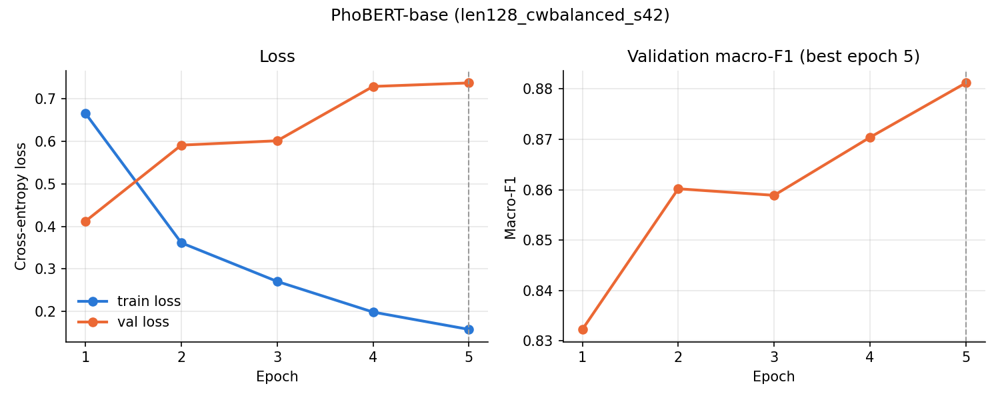
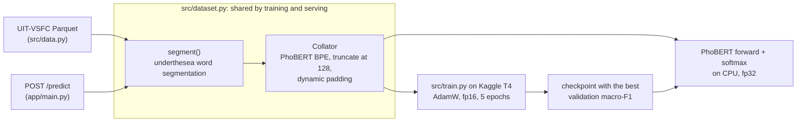

# Vietnamese Sentiment Classification with PhoBERT

Fine-tuning [`vinai/phobert-base`](https://huggingface.co/vinai/phobert-base) to classify Vietnamese student-feedback sentences from UIT-VSFC as negative, neutral or positive. The project covers the full path: exploratory data analysis, a TF-IDF + logistic regression baseline, a hand-written PyTorch training loop run on a Kaggle T4 GPU, three seeds per configuration, an error analysis against the baseline and across seeds, a FastAPI service with CPU latency measurements, an int8 quantization experiment and a Dockerfile. The emphasis is on measurement and on keeping the test set out of every decision. The hard part of this dataset is the neutral class (about 4% of the training sentences): every PhoBERT run is above 93% accuracy, but neutral F1 is only 0.56–0.61.

## Results

All numbers come from files in [`results/`](results/). The test set has 3,166 sentences. Each PhoBERT run was scored on test exactly once, after its checkpoint had been fixed on validation (see [Evaluation methodology](#evaluation-methodology)).

| Model | Val macro-F1 | Test macro-F1 | Test accuracy | Test neutral F1 |
|---|---|---|---|---|
| TF-IDF (1–2-grams) + logistic regression, 1 run | 0.793 | 0.749 | 0.885 | 0.426 |
| PhoBERT-base, plain cross-entropy, 3 seeds | 0.856 ± 0.005 | 0.831 ± 0.007 | 0.939 ± 0.001 | 0.581 ± 0.023 |
| **PhoBERT-base, class-weighted cross-entropy, 3 seeds** | 0.876 ± 0.007 | **0.834 ± 0.003** | 0.938 ± 0.005 | 0.591 ± 0.002 |
| PhoBERT-base, selected checkpoint (weighted, seed 42, served by the API) | 0.881 | 0.836 | 0.942 | 0.590 |
| *Literature:* PhoBERT, reported in BamiBERT (Table 2) | – | 83.27 (F1 type not stated) | 94.10 | – |
| *Literature:* XLM-R, same table | – | 82.20 (F1 type not stated) | 93.56 | – |

- **Read the mean ± std rows as the headline.** They are the mean and sample standard deviation (ddof = 1) over seeds 42, 43 and 44. The selected checkpoint is a single draw; it is reported because it is the model behind the API. Sources: `results/phobert_summary.json`, `results/baseline.json`.
- PhoBERT raises test macro-F1 by about 8.5 points over the baseline (0.749 → 0.834) and halves the number of test errors (364 → 185 for the selected run). Most of what is left is the neutral class.
- The class-weighted loss won on validation by 2.0 points, but on test it is only 0.3 points ahead, well inside the seed-to-seed spread (see [Key findings](#key-findings)).
- **Literature rows are context, not a like-for-like comparison.** The BamiBERT paper ([arXiv 2607.02259](https://arxiv.org/html/2607.02259v1)) does not say whether its F1 is macro or weighted. Its F1 (83.27) is far below its accuracy (94.10), which fits macro-F1 better than weighted F1 (the weighted F1 of the selected run here is 0.939), but this is an inference. Word segmentation, hyperparameters and number of runs also differ. I do not claim to match or beat the published number.

All six runs (`results/phobert_len128_cw{none,balanced}_s{42,43,44}.json`):

| Class weights, seed | Best epoch (val macro-F1) | Epoch of lowest val loss | Val macro-F1 | Test macro-F1 | Test accuracy | Test neutral F1 |
|---|---|---|---|---|---|---|
| none, 42 | 5 | 2 | 0.8531 | 0.8286 | 0.9390 | 0.5745 |
| none, 43 | 4 | 2 | 0.8522 | 0.8255 | 0.9397 | 0.5614 |
| none, 44 | 3 | 3 | 0.8619 | 0.8388 | 0.9384 | 0.6059 |
| **balanced, 42 (selected)** | 5 | 1 | **0.8812** | 0.8357 | 0.9416 | 0.5903 |
| balanced, 43 | 5 | 3 | 0.8674 | 0.8359 | 0.9406 | 0.5931 |
| balanced, 44 | 3 | 1 | 0.8784 | 0.8311 | 0.9330 | 0.5897 |



Confusion matrices: [selected run](results/figures/cm_phobert_len128_cwbalanced_s42.png), [baseline](results/figures/cm_baseline.png); curves and matrices for every run are in [`results/figures/`](results/figures/).

## Data

[UIT-VSFC](https://huggingface.co/datasets/uitnlp/vietnamese_students_feedback) contains sentences from Vietnamese university students' feedback on teaching, labelled with sentiment (3 classes, used here) and topic (4 classes, not used). `src/data.py` downloads the Parquet files that Hugging Face converts automatically (the dataset repo only has a loading script, which `datasets` ≥ 4.0 no longer runs). **The data is downloaded by the code and is not redistributed in this repository.**

| Split | Sentences | Negative | Neutral | Positive |
|---|---|---|---|---|
| train | 11,426 | 5,325 (46.6%) | 458 (4.0%) | 5,643 (49.4%) |
| validation | 1,583 | 705 (44.5%) | 73 (4.6%) | 805 (50.9%) |
| test | 3,166 | 1,409 (44.5%) | 167 (5.3%) | 1,590 (50.2%) |

Findings from [`notebooks/01_eda.ipynb`](notebooks/01_eda.ipynb) (summary in `results/eda_summary.json`, figures [label distribution](results/figures/label_distribution.png) and [lengths](results/figures/length_distribution.png); notebook commentary and figure labels are in Vietnamese):

- **Imbalance.** In train, positive outnumbers neutral 12.3 to 1. A model that never predicts neutral loses at most 5.3% test accuracy, so accuracy says almost nothing about this class. Macro-F1 weights the three classes equally and is the main metric.
- **Format.** The text is already lowercased (0 sentences with uppercase letters in any split) and punctuation is separated by spaces. Sentences are short: median 11 syllables, train p95 33.
- **Placeholders.** The dataset replaces some content with Latin strings. Five families were found in train; their meanings are **inferred from context**, since the dataset card does not document them. They were left unchanged.

  | Family | Inferred meaning | Occurrences (sentences) in train |
  |---|---|---|
  | `wzjwz<number>` | a person's name, usually after "thầy"/"cô" (teacher) | 238 (211) |
  | `colon…` (`colonsmile`, `colonsad`, …) | emoticons | 85 (85) |
  | `doubledot` | ":" (`11doubledot55` = 11:55) | 87 (85) |
  | `dot` | "." (`1dot5` = 1.5) | 43 (41) |
  | `fraction` | "/" ("thầy fraction cô" = thầy/cô) | 19 (18) |

- **Leakage check.** No validation or test sentence appears in train exactly (also after lowercasing). After removing punctuation, 27 validation sentences (1.7%) and **46 test sentences (1.45%)** match a train sentence; 45 of those 46 have the same label as in train. The selected model gets all 45 right and the one with a conflicting label wrong, so near-duplicates make the test score slightly optimistic. Without these 46 sentences its test accuracy would drop by less than 0.1 points (184 errors in 3,120 sentences instead of 185 in 3,166); the effect on macro-F1 was not computed.
- **`max_len`.** Measured on train only, after word segmentation and including `<s>`/`</s>`: p50 11, p95 30, p99 46, max 129 PhoBERT tokens. `max_len` 64 / 96 / 128 would truncate 27 / 2 / 1 of 11,426 sentences. 128 was chosen; with dynamic padding a larger limit costs nothing for typical batches.

## Method



- **Baseline** (`src/baseline.py`). Count or TF-IDF vectorizer + logistic regression, grid of 48 configurations (2 vectorizers × 2 n-gram ranges × 2 class weightings × 6 values of C), selected by validation macro-F1. The token pattern is `\S+`, because scikit-learn's default drops one-character tokens such as the syllables "ở", "ý" and punctuation. Winner: TF-IDF, 1–2-grams, `class_weight="balanced"`, C = 2.
- **Word segmentation.** PhoBERT was pretrained on word-segmented text (`giảng viên` → `giảng_viên`), so inputs are segmented with `underthesea.word_tokenize(text, format="text")` (underthesea 9.5.0). **Trade-off:** VinAI used VnCoreNLP's RDRSegmenter for pretraining. underthesea was chosen because it installs with pip (VnCoreNLP needs Java), which keeps the Docker image simple. The segmenter mismatch may cost some accuracy; this was not measured.
- **Training loop** (`src/train.py`, no Hugging Face `Trainer`). `AutoModelForSequenceClassification` with a new 3-way head; AdamW (lr 2e-5, weight decay 0.01); linear warmup over the first 10% of steps (179 of 1,790) then linear decay; batch size 32; 5 epochs; fp16 autocast with `GradScaler` (the T4 has no bf16); gradients unscaled before clipping at norm 1.0; loss computed in fp32 outside the model so that class weights can be applied; dynamic padding to the longest sentence of each batch. Seeds fix Python, NumPy and PyTorch RNGs and cuDNN is set to deterministic mode.
- **Class-weighted experiment.** Plain cross-entropy vs cross-entropy with `balanced` weights w_c = N / (3 · N_c), i.e. 0.72 / 8.32 / 0.67 for negative / neutral / positive. Each configuration was trained with 3 seeds.
- **Selection and test.** After every epoch the model is scored on validation and a checkpoint is saved only when validation macro-F1 improves. At the end, the saved checkpoint is reloaded from disk (the same files the API serves) and scored on test once. The rule for choosing between configurations was written before the runs (see [Evaluation methodology](#evaluation-methodology)).
- **Compute.** Kaggle T4, driven from the command line with the Kaggle API: `kaggle/build_kernel.py` embeds `src/*.py` into a private script kernel, so the code on Kaggle is exactly the code in this repo. About 41 s per epoch, 3.5 minutes per run (209.5–215.0 s), peak GPU memory allocated by tensors 3,367–3,380 MiB (`torch.cuda.max_memory_allocated`). The six runs ran one after another in a single kernel session. Scoring the full test set took about 2.2 s on the T4, excluding segmentation.

## Key findings

**Sanity check: the first loss is close to ln 3.** A freshly initialised 3-way head predicts roughly uniform probabilities, so the first cross-entropy should be near −ln(1/3) = 1.0986 (with or without class weights, since the weighted mean of equal losses is the same). The six runs logged 1.0956–1.1425 at step 1. A value far from this would have pointed to a bug in labels, loss or head before spending GPU time.

**Validation loss rises while validation macro-F1 keeps improving.** In every run, validation loss reached its minimum at epoch 1–3 and was higher at epoch 5; in 5 of 6 runs the best validation macro-F1 came after that minimum. In the selected run, validation loss went from 0.412 (epoch 1) to 0.738 (epoch 5) while validation macro-F1 went from 0.832 to 0.881. The model gets more sentences right but becomes over-confident on the ones it gets wrong, which cross-entropy punishes heavily. Since predictions use the argmax, checkpoints are selected by macro-F1, not by loss. The over-confidence is visible on test too: 147 of the 185 errors of the selected run have a predicted probability ≥ 0.9, so the raw probabilities should not be read as calibrated confidence. (In the weighted runs the validation loss is also weighted, with neutral × 8.3, so its values are not comparable with the unweighted runs.)

**Validation is optimistic compared with test.** Selected run: 0.881 on validation, 0.836 on test; weighted configuration on average: 0.876 vs 0.834. The checkpoint is the best of 5 epochs × 3 seeds, each scored on a small validation set with only 73 neutral sentences (one of them is worth 1.4 points of neutral recall), so the chosen value is biased upwards. This is why test is scored once and reported separately.

**The class-weighted loss gain does not survive on test.** By the pre-registered rule the weighted configuration was chosen (validation 0.876 vs 0.856). On test it is ahead by 0.3 points (0.834 vs 0.831), less than the standard deviation of the unweighted runs (0.007), and the best single test score (0.839) belongs to an unweighted run that was not selected. There is no evidence that class weighting helps on test. The choice stands because changing it after looking at test would turn test into a second validation set.

**For the baseline, `class_weight="balanced"` moves the neutral threshold, not the F1.** Best unweighted configuration on validation (count vectorizer, 1–2-grams, C = 4): macro-F1 0.792, neutral precision 0.574 / recall 0.480 / F1 0.522. Best weighted one: macro-F1 0.793, neutral precision 0.458 / recall 0.603 / F1 0.521. Weighting traded precision for recall with no gain in F1. The baseline's strongest negative-class n-grams are "nên" (should), "chưa" (not yet), "không" (not) and "cần" (need), i.e. suggestion and negation words; both come back in the error analysis (`results/baseline_top_ngrams.json`).

## Error analysis

`src/error_analysis.py` recomputes everything from the saved predictions (`results/error_analysis.json`). The selected run makes **185 errors on 3,166 test sentences** (5.8%, 95% CI 5.1–6.7%), against 364 (11.5%) for the baseline.

| True → predicted | Errors | Share of errors |
|---|---|---|
| neutral → positive | 55 | 29.7% |
| positive → negative | 45 | 24.3% |
| neutral → negative | 27 | 14.6% |
| negative → positive | 22 | 11.9% |
| negative → neutral | 20 | 10.8% |
| positive → neutral | 16 | 8.6% |

- **Neutral.** The model predicts neutral 121 times, 85 of them correctly (precision 0.70), and finds 85 of the 167 neutral sentences (recall 0.51). The 82 misses go mostly to positive (55). Short descriptive sentences sit on the boundary, for example "có demo trực tiếp ." ("there are live demos"), labelled neutral and predicted positive.
- **PhoBERT vs baseline, sentence by sentence.** Both right: 2,761. PhoBERT fixes 220 baseline errors and breaks 41 baseline-correct sentences. Both wrong: 144 (113 of them with the same wrong label).
- **Negation.** 642 test sentences contain "không", "chưa", "chẳng", "chả" or "đừng" (excluding "không khí", "không gian", where "không" is not a negation). The baseline makes 85 errors on them, PhoBERT **34** (55 fixed, 4 broken). The baseline is worse on these sentences than overall (13.2% vs 11.5%); PhoBERT is not (5.3% vs 5.8%). Example: "thầy giảng khá hay , không buồn ngủ ." ("the lecturer teaches quite well, it doesn't make you sleepy"), positive: baseline negative, PhoBERT positive. Likewise "chất lượng tốt không cần cải tiến ." ("good quality, no need to improve").
- **The errors are systematic, not seed noise.** 159 of the 185 errors are wrong in all three weighted seeds (146 with the same wrong label); 144 are wrong in all six runs, and 118 of those are also wrong for the baseline. More seeds or more tuning would not fix them; the causes are in the data and labels.
- **A labelling convention the model learns.** In train, 995 sentences start with a suggestion word ("nên", "cần", "mong", "hy vọng"/"hi vọng", "thêm", optionally after "thầy"/"cô"/"giảng viên"); **971 of them (97.6%) are labelled negative**, 18 positive and 6 neutral. The model follows this convention, so the rare suggestion labelled otherwise becomes an error: "nên cho thực hành nhiều hơn ." ("should give more practice") is labelled positive in test, and both models predict negative. Short thank-you sentences (≤ 8 tokens) have no consistent convention at all: 18 neutral and 12 positive in train.
- **Mixed sentences.** Praise followed by criticism is hard to place: "thầy dạy dễ hiểu tuy nhiên nhiều lúc hơi nhanh ." ("easy to understand, but sometimes a bit fast") is labelled negative, and PhoBERT predicts neutral.
- **Placeholders** do not stand out: 11 errors in 146 test sentences with a placeholder (7.5%, 95% CI 4.3–13.0%) vs 5.8% overall.

**Manual categorisation (not reported yet).** A first pass sorting all 185 errors into causes (neutral boundary, suggestions, apparent label inconsistency, negation/implicature/sarcasm, praise and criticism in one sentence, off-topic, English/placeholders/typos) was done by a single annotator with AI assistance. The author has not spot-checked it yet, so its counts are left out of this README.

## Serving

### API

`app/main.py` (FastAPI). Interactive docs at `/docs`.

- `GET /health` → `200 {"status": "ok", "model_loaded": true, "model": ..., "quantization": "none", "load_seconds": ...}` once the model is loaded, otherwise `503 {"status": "loading", ...}`.
- `POST /predict` with `{"texts": [...]}` → one label and three class probabilities per text, in the same order, plus the model name, `max_len` and quantization mode.

```bash
curl -s -X POST http://127.0.0.1:8000/predict -H "Content-Type: application/json" \
  -d '{"texts": ["giảng viên dạy rất nhiệt tình và dễ hiểu", "thầy dạy quá nhanh , không hiểu gì cả"]}'
```

```powershell
# Windows PowerShell 5.1: send UTF-8 bytes, otherwise Vietnamese characters are mangled
$body = '{"texts": ["giảng viên dạy rất nhiệt tình và dễ hiểu", "thầy dạy quá nhanh , không hiểu gì cả"]}'
Invoke-RestMethod -Method Post -Uri http://127.0.0.1:8000/predict `
  -ContentType "application/json; charset=utf-8" -Body ([Text.Encoding]::UTF8.GetBytes($body))
```

Response shape (probabilities omitted; `tests/test_api.py` checks that these two sentences get these labels):

```
{"model": {"name": "phobert_len128_cwbalanced_s42", "base_model": "vinai/phobert-base", "max_len": 128, "quantization": "none"},
 "predictions": [{"label": "positive", "probabilities": {"negative": ..., "neutral": ..., "positive": ...}},
                 {"label": "negative", "probabilities": {...}}]}
```

### Design

- **Load once.** Tokenizer and model are loaded in the lifespan hook, with one warm-up call so underthesea's lazily loaded model is ready too. A wrong `MODEL_DIR` stops the server at start-up instead of failing on every request.
- **Same preprocessing as training.** The API calls the same `segment()` and `Collator` from `src/dataset.py` that training used, with the same `max_len`, instead of re-implementing them, to avoid train/serve skew. `src/check_serving.py` sends 300 validation sentences through `/predict` (in chunks of 50) and through the offline evaluation path (batches of 64) and requires identical labels and probabilities within 1e-4. Its last run printed 300/300 identical labels and a maximum probability difference of 1.2e-7; this output is printed, not stored in `results/`. Separately, `results/quantization.json` shows that fp32 predictions do not depend on batch composition: 0 label changes between batch 1 and batch 64 over the whole validation set (maximum probability difference 5.5e-6).
- **Input limits.** 1–64 texts per request, 1–1,000 characters each, not whitespace-only; anything else returns 422. 128 tokens are a few hundred characters, so longer texts would only slow segmentation while their tail is truncated anyway. Texts are passed through unchanged (not stripped or lowercased), exactly as in training.
- **Sync endpoint.** `/predict` is a plain `def`, so FastAPI runs it in its threadpool: inference does not block the event loop and `/health` keeps answering during a prediction.
- **Health.** `/health` returns 200 only when the model is loaded. Under uvicorn the port does not accept connections until the start-up hook has finished, so the 503 branch is a defensive default for other setups.

### Latency (CPU, fp32)

Measured with `src/bench_latency.py` (`results/latency.json`) on one laptop: AMD Ryzen 7 6800H (16 logical CPUs, PyTorch using 8 threads), Windows 11, **Windows power plan "Silent"**, on AC power, PyTorch 2.15 CPU. Requests are validation sentences sent one at a time (no concurrency): 300 requests at batch 1 and 80 at batch 16, after 10 warm-up requests each. **These numbers depend on the machine and are noisy**: p95 at batch 16 is about twice the p50, and a second fp32 measurement a few minutes later (`results/quantization.json`) gave batch-1 p50 44.0 ms and p95 64.9 ms.

| Path | Batch | p50 per request | p95 per request | p50 per sentence |
|---|---|---|---|---|
| In-process (segmentation + tokenization + model) | 1 | 43.5 ms | 58.7 ms | 43.5 ms |
| In-process | 16 | 311.0 ms | 618.7 ms | 19.4 ms |
| HTTP to uvicorn on localhost (client side) | 1 | 43.4 ms | 56.6 ms | 43.4 ms |
| HTTP to uvicorn on localhost | 16 | 321.2 ms | 621.0 ms | 20.1 ms |

- The model forward pass is about 97% of the in-process time at batch 1; segmentation is 2% (batch 1) to 3.5% (batch 16). HTTP overhead is within the noise.
- **Cold start:** 10.5 s from launching uvicorn until `/health` returns 200, of which 4.5 s is loading the model plus the warm-up call.
- For scale, the TF-IDF baseline takes 0.56 ms per sentence (p50, batch 1, measured by `src/baseline.py` without the same harness) and is 1.56 MB on disk, against 515 MB for PhoBERT.

### Docker

```powershell
docker build -t phobert-sentiment-api:1.0 .
docker run --rm -p 8000:8000 -v "${PWD}/models:/models:ro" phobert-sentiment-api:1.0
# optional: -e MODEL_DIR=/models/<checkpoint folder>   -e QUANTIZE=int8
```

On macOS/Linux use `-v "$(pwd)/models:/models:ro"`. Design choices in the [`Dockerfile`](Dockerfile): `python:3.11-slim`; the CPU-only PyTorch wheel from the PyTorch index (the default Linux wheel ships CUDA libraries that are useless on CPU), installed first so that code changes reuse the cached layer; only `requirements-api.txt` (no Jupyter, pandas or scikit-learn); only `app/` and `src/dataset.py` are copied; **the model is not baked into the image** but mounted read-only, so changing the checkpoint does not require a rebuild; `HF_HUB_OFFLINE=1`; a non-root user; a `HEALTHCHECK` on `/health` written in Python (the slim image has no curl); one uvicorn worker, since each worker would hold its own copy of the model.

> **TODO: Docker measurements pending.** Image size, container cold start and latency through Docker have not been measured yet. They will be filled in from `results/latency.json` (`runs.fp32.docker`) after running `python -X utf8 -m src.bench_latency --targets docker`.

## int8 dynamic quantization: a measured negative result

`QUANTIZE=int8` applies `torch.ao.quantization.quantize_dynamic` to all `nn.Linear` layers. `src/quantization.py` compares it with fp32 on the same machine, measuring the two variants interleaved. The decision was made on validation; test was scored once afterwards for the record (`results/quantization.json`).

| | fp32 | int8 (dynamic) |
|---|---|---|
| Size (state dict) | 515.1 MB | 270.4 MB |
| Validation macro-F1 / accuracy | 0.881 / 0.955 | 0.826 / 0.941 |
| Validation neutral F1 | 0.712 | 0.569 |
| Test macro-F1 / neutral F1 (scored once) | 0.836 / 0.590 | 0.785 / 0.459 |
| Batch 1: p50 / p95 per request | 44.0 / 64.9 ms | 60.8 / 98.3 ms |
| Batch 16: p50 per request (per sentence) | 302.1 ms (18.9 ms) | 196.5 ms (12.3 ms) |
| Label changes between batch 1 and batch 64 (validation) | 0 | 21 |

- **Accuracy drops**, mostly on neutral: 41 of 1,583 validation predictions change, 23 of them away from neutral.
- **Batch 1 is slower**, batch 16 is about 1.5× faster (1.54× in this interleaved run; separate runs in `results/latency.json` gave 1.6×). A likely explanation is that the cost of quantizing activations on every call is not amortised over small matrices at batch 1; this was not profiled.
- **Labels depend on the batch.** Dynamic quantization computes activation scales from the whole batch, so the same sentence can get a different label depending on what it is sent with (21 changes on validation). This also breaks the batch-invariance test, which is skipped for int8.
- **The size only halves** because the word embedding matrix (64,001 × 768) and LayerNorm stay in fp32.
- `quantize_dynamic` is deprecated in PyTorch in favour of torchao.

**Decision: fp32 is the default.** int8 stays available behind `QUANTIZE=int8` for experiments only. The fp32 test numbers come from the Kaggle run (fp16 autocast on GPU); on CPU, the fp32 checkpoint reproduces the validation macro-F1 of training exactly (0.8812).

## Evaluation methodology

- **Main metric:** macro-F1 on test, plus per-class F1 and confusion matrices. Accuracy is reported but hides the neutral class.
- **Selection rule, fixed before the runs and based on validation only:** (1) choose the configuration (plain or weighted loss) with the higher mean validation macro-F1 over 3 seeds, preferring plain on a tie; (2) within it, choose the run with the highest validation macro-F1. Within a run, the epoch is chosen by validation macro-F1. Implemented in `src/summarize_runs.py`; the rule is stored in `results/phobert_summary.json`.
- **Test is scored once per run**, at the end of training, with the reloaded checkpoint. Test scores of both configurations are reported but were never used to choose. The baseline was selected on validation and scored on test once; its script was run a second time after a change to print formatting only, with identical numbers. The int8 variant was scored on test once, after the decision.
- **Uncertainty:** 3 seeds per configuration; mean ± sample standard deviation. With n = 3 the standard deviation itself is a rough estimate. Error rates in the error analysis come with 95% confidence intervals; groups under 30 sentences are flagged as small in the JSON.
- **Error analysis inputs:** saved predictions are matched to the test set by sentence text (the script first checks that test has no duplicate sentences), and each run's confusion matrix is rebuilt and checked against the one saved at training time.

## How to run

Requires Python 3.11. Commands are for Windows PowerShell from the project root; on macOS/Linux use `source .venv/bin/activate`. `-X utf8` avoids `UnicodeEncodeError` when Vietnamese text is printed on Windows.

```powershell
py -3.11 -m venv .venv
.\.venv\Scripts\Activate.ps1
pip install torch==2.15.0 --index-url https://download.pytorch.org/whl/cpu   # CPU wheel first
pip install -r requirements.txt

python -X utf8 -m src.data            # download UIT-VSFC Parquet -> data/raw/ (cached)
jupyter nbconvert --to notebook --execute --inplace notebooks/01_eda.ipynb   # -> results/eda_summary.json, figures
python -X utf8 -m src.baseline        # 48-config grid on validation, test once -> results/baseline*.json

# quick CPU smoke test of the training loop (tiny subset; real training runs on Kaggle)
python -X utf8 -m src.train --max_len 64 --class_weights none --subset 64 --epochs 1 --batch_size 8
```

**Training on Kaggle.** Needs `pip install kaggle` (not in `requirements.txt`), a Kaggle API token set up as in the Kaggle API documentation, and a phone-verified Kaggle account (required for GPU and internet; the kernel downloads the dataset and the PhoBERT weights). `kaggle/kernel-metadata.json` contains the placeholder `KAGGLE_USERNAME`; `build_kernel.py` fills it in from your local Kaggle configuration and writes the result to `kaggle/build/` (git-ignored), so no account name is committed. It also validates the run arguments locally, so a typo does not cost a GPU session.

```powershell
python -X utf8 kaggle/build_kernel.py `
  --run "--max_len 128 --class_weights none --seed 42" --run "--max_len 128 --class_weights none --seed 43" `
  --run "--max_len 128 --class_weights none --seed 44" --run "--max_len 128 --class_weights balanced --seed 42" `
  --run "--max_len 128 --class_weights balanced --seed 43" --run "--max_len 128 --class_weights balanced --seed 44"
kaggle kernels push -p kaggle/build
kaggle kernels status <your-kaggle-username>/phobert-uit-vsfc-sentiment
kaggle kernels output <your-kaggle-username>/phobert-uit-vsfc-sentiment -p kaggle/output --file-pattern "^results/"
# copy the run files from kaggle/output/results/ to results/, and download the selected checkpoint folder
# models/phobert_len128_cwbalanced_s42/ from the kernel output the same way (--file-pattern "^models/...")
```

On Kaggle the kernel keeps Kaggle's preinstalled GPU PyTorch (the recorded runs used Python 3.13 and torch 2.11 with CUDA) and pins `underthesea` and `transformers` to the versions in `requirements.txt`.

**Analysis, API, tests, benchmarks.** The fine-tuned checkpoint is not published, so these steps need `models/phobert_len128_cwbalanced_s42/` from the step above.

```powershell
python -X utf8 -m src.summarize_runs      # mean ± std, apply the selection rule -> results/phobert_summary.json
python -X utf8 -m src.error_analysis      # -> results/error_analysis.json

uvicorn app.main:app --host 127.0.0.1 --port 8000   # env: MODEL_DIR (checkpoint folder), QUANTIZE=none|int8
pytest                                    # 11 API tests; skipped if the checkpoint is missing
python -X utf8 -m src.check_serving       # API vs offline evaluation on 300 validation sentences

python -X utf8 -m src.bench_latency --targets inprocess uvicorn                 # -> results/latency.json
python -X utf8 -m src.bench_latency --quantize int8 --targets inprocess uvicorn
python -X utf8 -m src.bench_latency --targets docker                            # after docker build
python -X utf8 -m src.quantization        # fp32 vs int8 on validation -> results/quantization.json
python -X utf8 -m src.quantization --test # score int8 on test, run once
```

`src/error_analysis.py` reads `results/errors_*.csv` (written by the baseline and training runs), creates a blank `results/error_categories.csv` for manual labelling if none exists, and writes example sentences to `results/error_examples.json`. **These files are git-ignored because they contain dataset sentences**, so after a fresh clone they are regenerated by re-running the baseline and training.

## Project structure

```
app/main.py                  FastAPI service: load once, /health, /predict, input limits, optional int8
src/
  data.py                    download UIT-VSFC Parquet from Hugging Face (cached in data/raw/)
  dataset.py                 word segmentation, Dataset, Collator with dynamic padding (training and serving)
  baseline.py                Count/TF-IDF + logistic regression grid, test scored once
  train.py                   hand-written PyTorch fine-tuning loop, test scored once per run
  evaluate.py                metrics, confusion matrix, training curves, error CSV
  summarize_runs.py          mean ± std over seeds, validation-only selection rule
  error_analysis.py          errors vs baseline, across seeds, by group; labelling conventions in train
  check_serving.py           API vs offline evaluation (train/serve skew check)
  bench_latency.py           CPU latency: in-process, uvicorn, Docker
  quantization.py            fp32 vs dynamic int8: size, validation metrics, latency, batch dependence
kaggle/
  build_kernel.py            embed src/*.py into a private Kaggle script kernel
  kernel-metadata.json       kernel template (KAGGLE_USERNAME placeholder, T4, internet on)
notebooks/01_eda.ipynb       exploratory data analysis
tests/test_api.py            API tests with FastAPI's TestClient
results/
  eda_summary.json           splits, label counts, lengths, truncation, duplicates, placeholders
  baseline.json              full grid on validation, best config, test metrics, latency
  baseline_top_ngrams.json   top n-grams per class of the baseline
  phobert_len128_cw{none,balanced}_s{42,43,44}.json   one per run: config, versions, epoch log, val and test metrics
  phobert_summary.json       per-run table, mean ± std, selection rule and selected run
  error_analysis.json        error statistics only (example sentences go to the git-ignored error_examples.json)
  latency.json               CPU latency and environment
  quantization.json          fp32 vs int8
  figures/                   label and length distributions, confusion matrices, training curves
Dockerfile, .dockerignore    CPU image for the API
requirements.txt             full pinned environment; requirements-api.txt: what the API image needs
```

Not committed: `data/`, `models/`, `results/errors_*.csv`, `results/error_categories.csv`, `results/error_examples.json`, `kaggle/build/`, `kaggle/output/`. Code comments, the EDA notebook and some keys in the results JSON files are in Vietnamese.

## Limitations

- **Label noise and conventions.** Suggestions are almost always labelled negative (971/995 in train), short thank-you sentences are split between neutral and positive, and two near-duplicate sentence groups in train have conflicting labels. Part of the remaining error reflects the labels, not the model, and puts a ceiling on what any model can score.
- **Small neutral set.** 73 neutral sentences in validation and 167 in test. Neutral F1 and the validation-based choices built on it are noisy.
- **Near-duplicates.** 46 test sentences (1.45%) match a train sentence after removing punctuation; the test score is slightly optimistic.
- **Manual error categories** come from a single annotator with AI assistance and have not been spot-checked; their counts are not reported.
- **Latency** comes from one Windows laptop in the "Silent" power plan, with sequential requests only; there is no concurrency or load test, and numbers vary between runs. Docker numbers are still missing.
- **Segmenter mismatch.** underthesea is used instead of the VnCoreNLP segmenter used to pretrain PhoBERT; the effect was not measured.
- **No XLM-R comparison yet**, and the published numbers are not directly comparable (F1 type unknown, different setup).
- **Input format.** The model was trained on lowercased text with punctuation separated by spaces. The API deliberately applies only the training preprocessing, so input with capital letters or attached punctuation is out of distribution; its effect was not measured.
- **Probabilities are over-confident** (147 of 185 test errors have probability ≥ 0.9) and not calibrated.
- **Single domain.** Only student feedback on teaching; nothing here says how the model does on other Vietnamese text.
- **Environments differ.** Training ran on Kaggle (Python 3.13, torch 2.11 CUDA, fp16 autocast); serving and benchmarks on CPU (Python 3.11, torch 2.15, fp32). Seeds are fixed, but GPU runs are not guaranteed to be bit-identical when repeated.

## Possible next steps

- XLM-R-base without word segmentation, scored the same way, to test whether segmentation is needed at all.
- VnCoreNLP segmentation vs underthesea, same seeds.
- Author spot-check of the manual error categories, then report them.
- Temperature scaling on validation to calibrate probabilities; a tuned decision threshold for neutral.
- Report test scores with and without the 46 near-duplicates.
- Lowercasing and punctuation spacing in the API, checked with a consistency test.
- Static quantization with calibration data, or ONNX Runtime, instead of dynamic int8.
- Fill in the Docker measurements and add a concurrent load test.

## Citations and licenses

- Kiet Van Nguyen et al. 2018. *UIT-VSFC: Vietnamese Students' Feedback Corpus for Sentiment Analysis.* 10th International Conference on Knowledge and Systems Engineering (KSE 2018).
- Dat Quoc Nguyen and Anh Tuan Nguyen. 2020. *PhoBERT: Pre-trained language models for Vietnamese.* Findings of EMNLP 2020.
- Dat Quoc Nguyen, Thinh Pham, Chi Tran and Linh The Nguyen. 2026. *BamiBERT: A New BERT-based Language Model for Vietnamese.* [arXiv:2607.02259](https://arxiv.org/html/2607.02259v1) (source of the literature rows).
- Tools: [underthesea](https://github.com/undertheseanlp/underthesea), [VnCoreNLP](https://github.com/vncorenlp/VnCoreNLP), PyTorch, Hugging Face Transformers, scikit-learn, FastAPI.

**Data:** UIT-VSFC is listed with an unknown license on Hugging Face and is provided by the UIT NLP group for research. It is not redistributed here: the code downloads it, and files that list dataset sentences are git-ignored. This README quotes five test sentences and the EDA notebook shows about ten sentences as examples. **Model:** `vinai/phobert-base` is MIT-licensed according to its model card (PhoBERT-base-v2 was not used because of its AGPL-3.0 license). The fine-tuned checkpoint is not published. **Code:** no license has been chosen for this repository's code yet.
